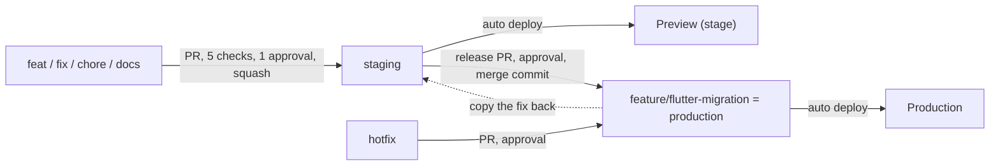

# Branching and deployment: how we ship Uniscope

One page the whole team follows. If this and another doc disagree, this one wins.
Last verified against GitHub and Railway: 2026-11-15.

## The cycle in 30 seconds

1. Pick a task in the Notion tracker.
2. Branch from `staging`: `feat/…`, `fix/…`, `chore/…` or `docs/…`.
3. Open a PR **into `staging`**. Fill in the PR template and name the risk tier.
4. Five automatic checks must be green, and **one teammate (not you) approves**.
5. **Squash and merge.** Railway deploys `staging` by itself.
6. Check your change on Preview (stage).
7. When Preview looks right, open a **release PR** from `staging` into production. A lead approves and merges it.
8. Railway deploys production by itself. Run the after-release checklist.

Mobile app builds and store uploads are a separate step (section 8).

## Who does what

| Person | Role | In this cycle |
|---|---|---|
| **Kiran** | Astyllex owner, technical lead | Owns infrastructure, secrets, production deploys and store accounts. Approves High and Critical changes and every release to production. |
| **Dheepan** | Product owner, client-facing | Decides what gets built and in what order, and signs off from the client's point of view that a change is right **before** it is released. Does not need to review code. |
| **Anusuya** and **Mega** | Developers (same role) | Build, test and open PRs. Review each other's PRs. Cut and check releases with Kiran. |

"A lead" in this guide means Kiran. If Kiran is away, the one who covers must be named in the release PR.

## 1. Where things run

| Environment | What it is | Backend | Deploys from |
|---|---|---|---|
| **Local** | Your machine | `localhost:3001` | nothing, you run it |
| **Preview (stage)** | Test copy | `uniscope-staging.up.railway.app` | branch `staging` |
| **Production** | Real users | `uniscope-production.up.railway.app`, admin at `admin.uniscope.in` | branch `feature/flutter-migration` |

Only these three exist. Say "Preview (stage)" and "Production" everywhere (Sentry, Notion, PRs).

> **Staging shares the production database** (reported in PR #50; confirm with a lead).
> Anything you do on Preview, including a test payment or a migration, touches real data.
> Use a test account only. See section 7 for what that means for database changes.

Railway deploys the moment a commit lands on the branch. It does **not** wait for CI (`checkSuites` is off). The protection is the PR rules below, not the deploy.

**What GitHub enforces today (2026-11-15):** only the production branch, which needs 1 approval (no required checks). `staging` and the website branches have **no** rule right now, so the "5 checks + 1 approval" below is a team rule that GitHub is not yet enforcing (gap 5).

## 2. The branches

| Branch | What it is | Who merges into it |
|---|---|---|
| `staging` | Where all work lands first. Deploys to Preview (stage). | Anyone, through a PR (team rule: 5 checks + 1 approval) |
| `feature/flutter-migration` | **Production.** The name is historical. | A lead, through a release PR (GitHub enforces 1 approval) |
| `feat/…` `fix/…` `chore/…` `docs/…` | Your work. Short-lived: delete after merge. | You |
| `release/YYYY-MM-DD` | The release PR's branch, cut from `staging`. | A lead |
| `hotfix/…` | Urgent production fix, cut from production. | A lead |
| `stage/web-enrollment-site` → `prod/web-enrollment-site` | The website's own pair (section 9). | Through PRs |
| `main`, `develop` | **Do not use.** Stale. | nobody |

## 3. Step by step

1. **Task.** Work from a Notion item (Status "able to pick") and keep its Status current as it moves: In Testing → Stage → Production → Completed.
2. **Branch.** `git switch staging && git pull`, then `git switch -c feat/short-name`. Never commit to `staging` or production directly.
3. **Build and test locally.** Run `npm run lint --workspaces`, `npm run test --workspaces`, and for the app `flutter analyze` and `flutter test`.
4. **Open the PR into `staging`.** Title in the commit style (below). Fill in the template, set the **risk tier** from `ai/RISK_RULES.md`, and say what you tested and what you did not.
5. **Checks and review.** The five checks are: engineering rules, backend (lint, build, test), admin (build), web (build), mobile (analyze, test). Someone other than you approves. See section 5 for who.
6. **Merge.** Squash and merge (section 6). Delete the branch.
7. **Verify on Preview.** Deploys take about 5 minutes. Do your own check there and move the Notion item to Stage.
8. **Release.** A lead opens `release/YYYY-MM-DD` from `staging` into production, lists what ships, and notes any database migration. After approval it is merged with a merge commit.
9. **After the release.** Check `/health`, log in to the admin, log in with an OTP, open the app on a device. Move the Notion items to Production (and to Completed once a day of Sentry stays quiet). Watch Sentry for the first hour.

## 4. Names and messages

- **Branches:** `feat/`, `fix/`, `chore/`, `docs/`, `hotfix/` plus a short name. Example: `feat/web-wallet-topup`.
- **Commits and PR titles:** imperative, with a scope. Example: `fix(backend): handle MSG91 network failures`. Scopes: `mobile`, `backend`, `admin`, `web`, `docs`, `infra`.
- **One PR, one purpose.** Small PRs get reviewed faster.
- **Never** put a key, secret or password in a branch, a PR, a Notion item or a chat. Use Railway or Vercel variables (see CLAUDE.md, "Secrets").

## 5. Who approves what (proposed: team to confirm)

The risk tier is in `ai/RISK_RULES.md`. The author never approves their own PR.

| Tier | Examples | Who approves |
|---|---|---|
| **Low** | docs, tests, copy, formatting | the other developer (Anusuya or Mega) |
| **Medium** | normal features, admin screens, new endpoints | the other developer (Anusuya or Mega) |
| **High** | login or OTP, wallet and payments, database schema, notifications, native app config | Kiran **and** the other developer |
| **Critical** | production credentials, webhook signature checks, deleting data, store publishing | explicit written go-ahead from Kiran for that specific action |
| **Release to production** | any release PR | Kiran approves and merges. Dheepan confirms the client-facing sign-off first (a comment on the release PR is enough). |

If a developer's own PR is the only one open, Kiran reviews it.

Admin override (merging without approval) is for emergencies only. Write the reason in the PR.

## 6. How to merge

| PR | Method | Why |
|---|---|---|
| Your branch into `staging` | **Squash and merge** | One clean commit per change, easy to undo. |
| Release PR into production | **Create a merge commit** | Keeps `staging` and production history connected, so releases stop drifting apart. |
| Anything | **Not** "Rebase and merge" | It rewrites commit IDs and breaks the link between a PR and what landed. |

## 7. Database changes

Migrations run **every time the backend starts** (`prisma migrate deploy`). Because Preview shares the production database, a migration that ships to Preview is live for production users at once, before the production code changes.

- Make every migration safe for the code that is running in production **right now**.
- Add first, switch the code over, remove later (never drop or rename in one step).
- A destructive migration is **Critical** and needs Kiran's explicit approval.
- Say "migration included" in the PR title or first line.

## 8. The mobile app

- App changes go into `staging` like any other, but **users only get them in a new store build.** A merged fix is not live for app users until then.
- The version in `mobile_flutter/pubspec.yaml` is bumped by the person cutting the build. Build only from the production branch, so the store matches production.
- Builds use `scripts/build_android_release.sh` and `scripts/build_ios_release.sh`. Check that Android is signed with the release key (not debug).
- Test builds may point at Preview with `--dart-define=API_URL=https://uniscope-staging.up.railway.app/api/v1`.
- Old app builds stay in use for weeks, so the backend must keep working for them.
- Uploading to TestFlight, Play internal testing or the stores needs Kiran's explicit go-ahead each time.

## 9. The website (`web/`)

The website is deployed by Vercel from its **own two branches**:

`feat/web-…` → PR (squash) → `stage/web-enrollment-site` (Vercel preview) → release PR → `prod/web-enrollment-site` (**uniscope.in**).

- Web changes go to `stage/web-enrollment-site`, not `staging`. Do not edit `web/` on `staging` or production.
- Vercel needs a Preview-only `NEXT_PUBLIC_API_URL` pointing at the staging backend. Without it, previews talk to the **production** backend.
- Production is only updated by a release PR **from `stage/web-enrollment-site`** into `prod/web-enrollment-site`. Never push to it directly and never copy files across by hand: that is what caused the conflicts of 2026-11-15.
- GitHub enforces this on `prod/web-enrollment-site`: a PR with 1 approval, a green `web (build)`, and no force pushes or deletion (set 2026-11-17; admins can still override in an emergency). The check `release source (stage only)` makes any other source branch fail. It is required only once its workflow has reached production (PR #69, then a release).
- `stage/web-enrollment-site` is deliberately unprotected. The gate before uniscope.in is the release PR, so review it carefully.
- Razorpay must list `uniscope.in` and `www.uniscope.in` as registered websites, or website top-ups are blocked at the payment step.

## 10. Hotfix

1. Branch `hotfix/short-name` from the production branch.
2. PR into production with one approval. Keep it as small as possible.
3. After it ships, open a PR copying the same fix into `staging`, so the next release does not undo it.

## 11. Do and don't

- **Do** keep PRs small, say what you tested, and delete merged branches.
- **Do** tell the team before a release and after it.
- **Don't** push to `staging` or production directly, paste secrets anywhere, or release late at night unless it is a hotfix.
- **Don't** merge a PR whose checks are red, or "just to see it on Preview" with a risky database change.

## 12. Known gaps (decisions for the team)

| # | Gap | Suggested fix |
|---|---|---|
| 1 | Preview shares the production database. | Give Preview its own database, then tests and migrations stop touching real data. |
| 2 | The production branch is called `feature/flutter-migration`. | Rename it per section 13 (planned, Critical: Railway, Vercel and GitHub settings change together). |
| 3 | The website branches have drifted far from `staging` (hundreds of commits, 24+ files in `web/`). | Move the website onto the same two-step flow, or document the website as a separate product with its own owner. |
| 4 | Railway deploys without waiting for CI. | Turn on "wait for CI" for both environments. |
| 5 | `staging` and `stage/web-enrollment-site` have no GitHub rule (`staging` had "5 checks + 1 approval" earlier this month and it is gone). `prod/web-enrollment-site` is now protected; the production backend branch needs 1 approval but no required checks. | Turn "5 checks + 1 approval" back on for `staging` and require the checks on the production backend branch. Stage website branch is left open on purpose. |
| 6 | Dependabot opens PRs against `main`. | Point it at `staging`, group small updates, and cap open PRs. |
| 7 | No fixed release rhythm. | Pick one (for example every Tuesday) so everyone knows when production changes. |
| 8 | No named owner for the after-release checklist. | Assign one person per release. |

Related: `ai/RISK_RULES.md`, `ai/ENGINEERING_RULES.md`, `ai/DEFINITION_OF_DONE.md`, `ai/QA.md` (release QA), `CONTRIBUTING.md`.

## 13. Planned: one production branch per part (needs Kiran's approval)

**Decision (2026-11-17):** each part gets a production branch named after it, so nobody has to know that `feature/flutter-migration` means "production".

| Part | Today | New name |
|---|---|---|
| Backend (Railway `uniscope`, `/backend`) | `feature/flutter-migration` | `production-uniscope` |
| Admin panel (Railway `admin`, `/admin`) | `feature/flutter-migration` | `production-uniscope-admin` |
| Website (Vercel, `web/`) | `prod/web-enrollment-site` | `production-uniscope-web` |
| Mobile store builds | built from `feature/flutter-migration` | cut from `production-uniscope` (proposal: no separate branch) |

Names are not final until Kiran confirms them. Stage branches are unchanged for now (`staging`, `stage/web-enrollment-site`).

**What the split costs:** backend and admin are in one repository and today ship together from one branch. With two branches, every release has two release PRs (staging into `production-uniscope`, staging into `production-uniscope-admin`), and the admin must never be released before the backend it calls. Keep them in step, or keep one branch for both.

**Order of the rename (a planned Critical change, outside working hours, nothing is deleted until the end):**
1. Create the new branches from the current production heads. Nothing deploys yet.
2. Copy the branch rules to the new branches (1 approval, required checks, no force push, no deletion), and add the source-branch check.
3. Update everything that names the old branches: `.github/workflows/*.yml` (`branches:` lists and the release-source checks), this guide, `CLAUDE.md`, `CONTRIBUTING.md`, `ai/RELEASE.md`, the PR template.
4. Change the source branch in Railway (production `uniscope` and `admin`) and the Production Branch in Vercel. Each redeploys once. Then check `/health`, the admin login and uniscope.in.
5. Tell the team in one message: new release PR targets, old names retired.
6. After one quiet week, delete the old branches.

**Rollback:** point Railway and Vercel back at the old branch names, which still exist until step 6.
